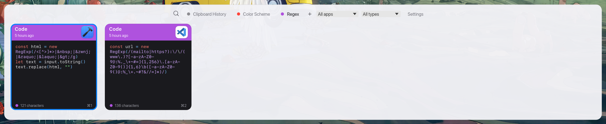

# RustPaste

<p align="center">
  <strong>A fast, lightweight, open-source clipboard manager for macOS written in Rust.</strong><br>
  <em>Inspired by <a href="https://pasteapp.io">Paste</a>. Clean-room implementation — 100% local, private, and free of proprietary assets.</em>
</p>

<p align="center">
  
  
  
  
</p>

<p align="center">
  
</p>

---

> [!NOTE]
> **Language Notice:** The application user interface is currently localized in **Spanish** (*Español*). Multi-language / English localization support is planned for future releases.

---

## ⚡ Overview

Press **⇧⌘V** (Shift + Command + V) anywhere, and a sleek horizontal strip of cards slides up from the bottom of your active display with everything you've copied. Select an item, press Enter, and it is instantly pasted into the app you were using.

- **Visual & Intuitive:** Colored headers by data type, relative timestamps, source application icons, previews, and metadata footer.
- **Privacy-First:** Concealed data (passwords, 1Password, Bitwarden, Apple Passwords) is automatically ignored. Zero network telemetry.
- **Fast & Lightweight:** Built in Rust using `egui` and native macOS APIs (`objc2`, `NSPasteboard`, `CGEvent`). Everything is stored in a local SQLite database.

> **Preview screenshot tip:** Run `cargo run -- --show` to open the panel immediately at launch to capture screenshots or test themes.

---

## ✨ Features

- **Multi-Format Clipboard Monitoring:** Tracks text, rich text (RTF), images, web links, file paths, and color codes (`#RRGGBB`).
- **Interactive Card Strip:** Horizontal shelf displaying newest copies first.
- **Pinboards:** Organize frequently used clips into custom-named, color-coded boards. Pinned clips never expire.
- **Instant Search & Filters:** Just start typing to filter clips in real time by content, title, or source application.
- **Keyboard-Driven Workflow:** Full control without touching the mouse (quick paste, preview, edit, pin, delete).
- **Privacy Controls:**
  - Automatic exclusion of sensitive pasteboard items (marked via `nspasteboard.org` standards).
  - Pre-configured blocklist for password managers (configurable in Preferences).
  - Pause clipboard recording at any time from the menu bar.
- **Data Retention & Storage:**
  - Configurable retention limits (by duration: day, week, month, year, or forever; and/or maximum item count).
  - All data is saved locally in SQLite (`~/Library/Application Support/RustPaste/`).

---

## ⌨️ Keyboard Shortcuts

| Shortcut | Action |
| --- | --- |
| `⇧⌘V` | Open / Toggle RustPaste panel (configurable in Settings) |
| `←` / `→` | Navigate through clipboard cards |
| `↩` (Enter) | Paste selected item into active application |
| `⇧↩` (Shift+Enter) | Paste selected item as plain text |
| `⌘1` – `⌘9` | Quick paste the corresponding item |
| `Space` | Quick Look / Full preview of selected card |
| `⌘R` | Rename clip title |
| `⌘E` | Edit text content directly |
| `⌘N` | Create a new clip manually |
| `Tab` / `⇧Tab` | Switch between pinboards |
| `⌫` (Backspace) | Delete selected clip from history |
| `⌘,` | Open Preferences / Settings window |
| `Esc` | Close panel |
| *Type any text* | Instant search across your clipboard history |

---

## 🔒 Permissions

RustPaste requires **Accessibility** permission in macOS to simulate direct `⌘V` keystrokes into the destination window:

1. Open **System Settings → Privacy & Security → Accessibility**.
2. Enable access for **RustPaste** (or your terminal emulator if running via `cargo run`).
3. You can also trigger the system prompt via the app's settings: *Ajustes → Conceder permiso...*.

> *Note:* If accessibility permission is not granted, RustPaste will still copy the item to the system clipboard so you can paste it manually.

---

## 🛠️ Requirements & Installation

### Requirements
- **macOS 14.0 (Sonoma)** or newer.
- **Rust 1.85+** (uses Rust 2024 edition).

### Building & Running from Source

```bash
# Clone the repository
git clone https://github.com/your-username/rustpaste.git
cd rustpaste

# Run in development mode
cargo run --release

# Run unit tests
cargo test --lib
```

### Packaging as a macOS App (`.app`)

To build an ad-hoc signed `.app` bundle:

```bash
scripts/bundle.sh
```

The resulting application will be placed at `dist/RustPaste.app`.

#### Signing and Notarization (Optional)
If you have an Apple Developer account, configure environment variables before bundling:

```bash
SIGN_ID="Developer ID Application: Your Name (TEAMID)" \
NOTARY_PROFILE="my-profile" \
scripts/bundle.sh
```

---

## 🏛️ Architecture

RustPaste is built cleanly with modular separation:

| Module | Description |
| --- | --- |
| [`src/model.rs`](file:///Users/fabsanh/Proyectos/rustpaste/src/model.rs) | Data models (`ClipItem`, content classification, hashing, types) |
| [`src/store.rs`](file:///Users/fabsanh/Proyectos/rustpaste/src/store.rs) | SQLite persistence, pinboards, de-duplication, and history retention |
| [`src/monitor.rs`](file:///Users/fabsanh/Proyectos/rustpaste/src/monitor.rs) | Background thread polling `NSPasteboard.changeCount` |
| [`src/privacy.rs`](file:///Users/fabsanh/Proyectos/rustpaste/src/privacy.rs) | Filtering of password managers and concealed/transient data |
| [`src/settings.rs`](file:///Users/fabsanh/Proyectos/rustpaste/src/settings.rs) | Persistent JSON preferences and atomic saving |
| [`src/mac/`](file:///Users/fabsanh/Proyectos/rustpaste/src/mac) | macOS native integrations (`objc2`, `NSPasteboard`, `CGEvent`, Accessibility) |
| [`src/ui/`](file:///Users/fabsanh/Proyectos/rustpaste/src/ui) | `egui` borderless panel, tray icon, custom widgets, and settings window |

---

## 📁 Data Storage

All data is stored strictly on your local machine:
- Database: `~/Library/Application Support/RustPaste/history.sqlite`
- Image Thumbnails: `~/Library/Application Support/RustPaste/images/`
- Configuration: `~/Library/Application Support/RustPaste/settings.json`

---

## 🗺️ Roadmap & Known Limitations

- [ ] Multi-language support (English & Spanish UI toggle)
- [ ] Native background blur effects (`NSVisualEffectView`)
- [ ] Asynchronous image thumbnail decoding
- [ ] Optical Character Recognition (OCR) for images

---

## 📄 License

This project is licensed under the [MIT License](LICENSE).
